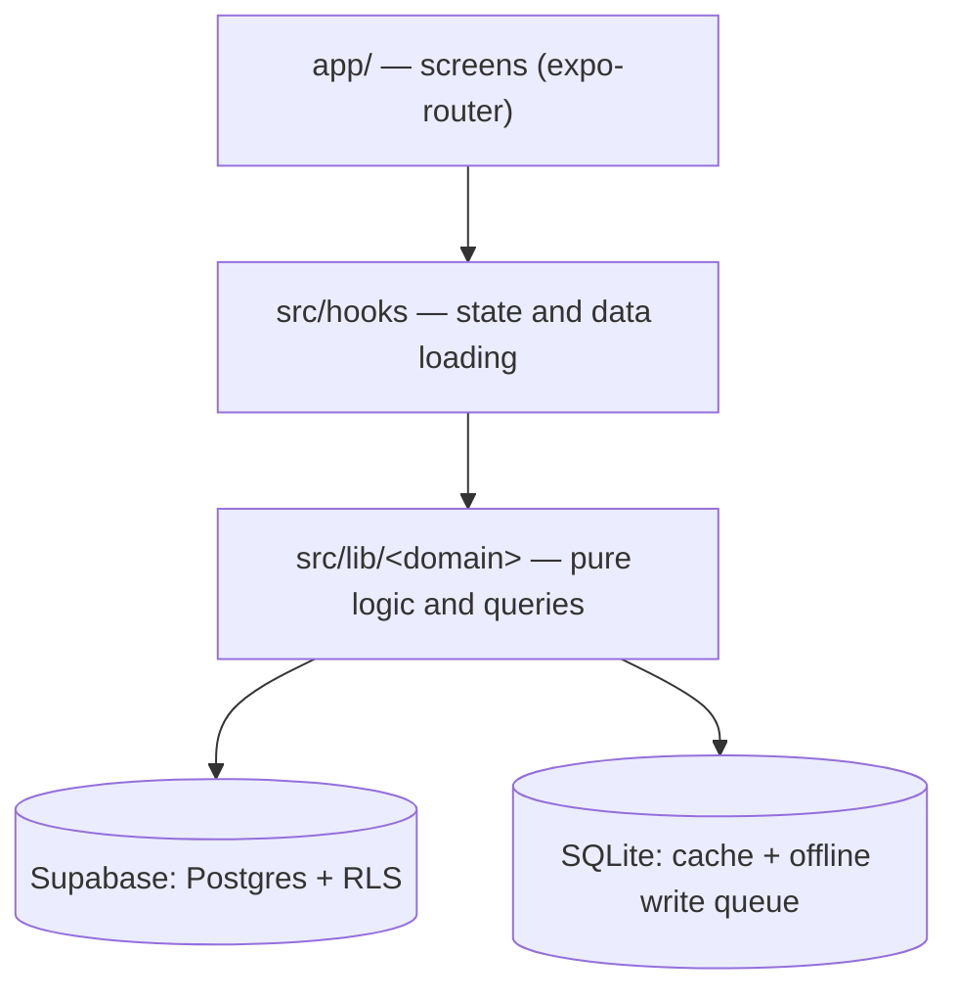

# Fit Tracker

A gym workout tracker for Android that tells you what to lift today, works offline between sets, and tracks your progression for you.

<!-- GIF: docs/media/demo.gif -->

<!-- APK: link to the latest GitHub Release -->

**Try the demo account:** email `demo.fittracker@example.com`, password `fittracker123`. It comes with about 12 weeks of training history and resets every Monday and Thursday.

[](https://github.com/Gusa01/gym-tracker/actions/workflows/ci.yml)

## Why I built it

I logged my routines in a spreadsheet. Using a spreadsheet on my phone at the gym was a pain, and I kept losing track of my progression: what I lifted last time, and when it was time to go up.

So I built the app I wanted to use. I train with it, and the plan is to keep improving it: first friends use it and give feedback, and eventually it could become a product people pay for.

## What it does

- **Today's workout**, resolved from the active routine and the weekday, with sets logged between rest periods. Logging works offline and syncs when the connection comes back.
- **Progression suggestions**: top set / back-off and double progression schemes, a suggested weight for next time, and a deload suggestion after two sessions short of target.
- **Progress charts** per exercise (estimated 1RM, weight, reps or time), and a banner the moment a set beats a personal record.
- **Session history** with corrections: edit or delete a logged set after the fact.
- **Reminders** on training days, and a weekly streak with a warning before it breaks.
- **An exercise catalog** with images, muscle and equipment filters, and search by name or synonym that ignores accents and case.
- **Dark mode**, following the system or set by hand.
- **Drag to reorder** routine days and exercises.

The app's interface is in Spanish. The code and documentation are in English.

## Architecture



Screens render and handle input. Hooks own state and decide when to load, write and sync. The domain modules under `src/lib` hold the rules (progression, records, streaks, reminder planning) as plain functions, next to the queries that read and write each domain's tables.

```text
app/                 Screens and navigation (expo-router file-based routes)
  (auth)/            Sign-in and sign-up
  (app)/(tabs)/      Home, Rutinas, Historial, Progreso, Ajustes
  (app)/session/     The live workout screen
src/components/      Reusable UI; ui/ holds the themed primitives (text, buttons, cards)
src/hooks/           One hook per screen concern: data loading, mutations, sync triggers
src/lib/<domain>/    exercises, history, home, progress, progression, reminders, routines, sessions
src/lib/sqlite/      Local cache tables and the pending-writes queue
src/lib/sync/        Queue flushing and the sync triggers (network back, app foregrounded)
src/theme/           Color tokens, light/dark palettes, contrast helper, theme provider
supabase/migrations/ Schema, RLS policies, views and the exercise catalog seed, in order
scripts/             Routine importer, demo-account seed, catalog and icon build tools
tests/               Unit tests (pure logic) and integration tests (real Postgres)
```

## Engineering decisions

**Domain logic as pure functions.** Progression rules, PR detection, streaks and reminder planning are where bugs would hurt most, and they are hard to test through a phone. They live as pure functions that take data and a `now` and return a result, for example [`rules.ts`](src/lib/progression/rules.ts), [`live.ts`](src/lib/progress/live.ts) and [`plan.ts`](src/lib/reminders/plan.ts), so they run under Jest in milliseconds with no device, network or env vars. The trade-off is that the hooks wiring them together have no unit tests of their own; they are kept thin instead.

**Offline-first writes through a serialized queue.** Gym basements have bad signal, and a set must never be lost. Every write (a set, a session, a progression update) is stored first in a SQLite `pending_writes` table with a client-generated UUID, then flushed in creation order as idempotent upserts ([`flushQueue.ts`](src/lib/sync/flushQueue.ts)). Flushes are chained on a single promise so two never overlap ([`syncService.ts`](src/lib/sync/syncService.ts)), and if a write for a row fails, later writes for that same row are held back so they can't land out of order. The accepted trade-off is last-write-wins with no conflict resolution, which fits an app where one person logs from one phone.

**Deletes are upserts too.** Correcting history offline needed deletes to travel the same queue as every other write. Deleting a logged set sets `is_deleted` instead of issuing a `DELETE` ([migration](supabase/migrations/20261007120000_logged_sets_soft_delete.sql), [`submitCorrection.ts`](src/lib/history/submitCorrection.ts)), and routines have no delete policy at all, so the database itself refuses a hard delete ([RLS policies](supabase/migrations/20260914050552_rls_policies.sql)). The cost is that every read path has to filter out deleted rows.

**Security lives in the database.** The app ships the public anon key, so the client can't be trusted to filter by user. Every table has Row Level Security: user data is visible only to its owner through `auth.uid()`, and the shared catalog is read-only. The `exercise_set_history` view is created `with (security_invoker = true)` so it runs with the caller's permissions instead of bypassing RLS as its owner. The one privileged function, `merge_legacy_exercises`, is `security definer` with `execute` revoked from `anon` and `authenticated` ([seed migration](supabase/migrations/20261015120100_seed_exercise_catalog.sql)). Policies in SQL are easy to get subtly wrong, so [`rls.test.ts`](tests/db/rls.test.ts) checks them against a real Postgres.

**A catalog migration that kept everyone's history.** Replacing the hand-typed exercise list with a curated catalog risked orphaning routines, charts and progression state. The merge maps each legacy row to the catalog by name or alias, collapses duplicate progression rows to the most recently updated one *before* repointing (so the `(user_id, exercise_id)` key never collides), then repoints routines and state and removes the old rows. Logged sets reference routine exercises rather than exercises, so history needed no rewrite and merged exercises show one combined chart. It is written as a function so [`legacyMerge.integration.test.ts`](tests/lib/exercises/legacyMerge.integration.test.ts) can run it against seeded data; the price is a migration that can't be undone.

**Reading past PostgREST's 1000-row cap.** Supabase's API truncates every response at 1000 rows without an error, so a long training history would silently lose its oldest sets and the charts would lie. [`progress/queries.ts`](src/lib/progress/queries.ts) reads the history view in pages with a stable order (`session_date`, then `logged_set_id`) until a short page comes back. Heavy users pay a few extra round trips, and the result is cached in SQLite as per-exercise records so live PR detection works offline.

**Reminders planned 14 days ahead.** A local notification can't run code when it fires, so it can't check whether you already trained. [`planReminders`](src/lib/reminders/plan.ts) computes the next 14 days up front, skipping rest days and days already trained, plus a streak warning for the first Saturday that would close a week without a workout. [`scheduler.ts`](src/lib/reminders/scheduler.ts) cancels and reschedules the whole plan whenever Home loads, a session is completed or the settings change, serialized so overlapping runs can't duplicate notifications. Someone who doesn't open the app for two weeks stops getting reminders, which is a reasonable place to stop.

**Design tokens enforced by tests.** Dark mode only works if no screen hard-codes a color. All colors live in [`src/theme/colors.ts`](src/theme/colors.ts); [`no-color-literals.test.ts`](tests/theme/no-color-literals.test.ts) fails the build if a hex or `rgb()` literal appears anywhere in `app/` or `src/` outside the theme, and [`colors.test.ts`](tests/theme/colors.test.ts) checks key foreground/background pairs meet WCAG AA (4.5:1) in both palettes. The literal check is a regex, crude but enough to catch the mistake that matters.

**Degrading when a native module is missing.** Some app builds, such as Expo Go, lack native modules that `expo-notifications` loads on import, and Metro reports that failed import as fatal even inside a `try/catch`. [`notificationsModule.ts`](src/lib/reminders/notificationsModule.ts) checks each required native module first and only then requires the package; otherwise reminders are reported as unavailable and the rest of the app runs normally. The list of modules has to be kept in step with `expo-notifications` upgrades.

## Testing and CI

Tests are split in two Jest projects ([`jest.config.js`](jest.config.js)):

- **Unit tests** cover the pure logic: progression, records, trends, streaks, reminder planning, search, sync ordering, the theme and the demo-history generator. They need no env vars or network: `npm run test:unit`.
- **Integration tests** (`tests/db/` and `*.integration.test.ts`) run against real Postgres with Supabase Auth: RLS isolation between users, schema invariants, queries, the queue flush and the catalog merge.

On every pull request and push to `main`, [CI](.github/workflows/ci.yml) runs the type-check and unit tests, and in a second job boots a throwaway local Supabase in Docker (`supabase start`), applies every migration from scratch and runs the integration suite against it. CI never touches the hosted project and needs no secrets.

## Tech stack

- **Expo SDK 57 / React Native 0.86**: one codebase, Android build through EAS.
- **TypeScript**: strict types across app, scripts and tests, with typed routes.
- **expo-router**: file-based navigation.
- **Supabase**: Postgres, Auth and Storage, with RLS for authorization.
- **expo-sqlite**: local cache and the offline write queue.
- **react-native-gifted-charts**: progress charts.
- **Jest** with ts-jest: unit and integration tests.

## Running locally

You need Node 24 and a Supabase project.

```bash
npm install
cp .env.example .env.local   # fill in the Supabase URL and keys
npx supabase link --project-ref <ref> --password <db-password>
npx supabase db push         # apply the migrations
npx expo start
```

Then sign up in the app and import the starter routine with `npx tsx scripts/import-routine.ts <your-email>`.

The full guide, covering environment variables, linking the Supabase CLI, migrations, the demo account, the scheduled demo reset and building the APK, is in [docs/development.md](docs/development.md).

## Roadmap

1. Friends test it on their phones, and their feedback decides what comes next.
2. An iOS build.
3. Sharing routines between users.
4. What a paid product would need: onboarding without a pre-built routine, routine templates, and data export.

## En español

Fit Tracker es una app de gimnasio para Android: te dice qué entrenar hoy, registra las series sin conexión y lleva tu progresión por vos. La hice porque anotaba mis rutinas en una planilla, usarla en el celular en el gimnasio era incómodo y perdía el registro de cuánto había levantado y cuándo subir de peso. La uso para entrenar y la idea es seguir mejorándola, primero con amigos y después como producto. La interfaz de la app está en español; este README y el código están en inglés.

## Author

Agustín Castromil · [LinkedIn](https://www.linkedin.com/in/agustin-castromil) · [GitHub](https://github.com/Gusa01)

## License

[MIT](LICENSE)
